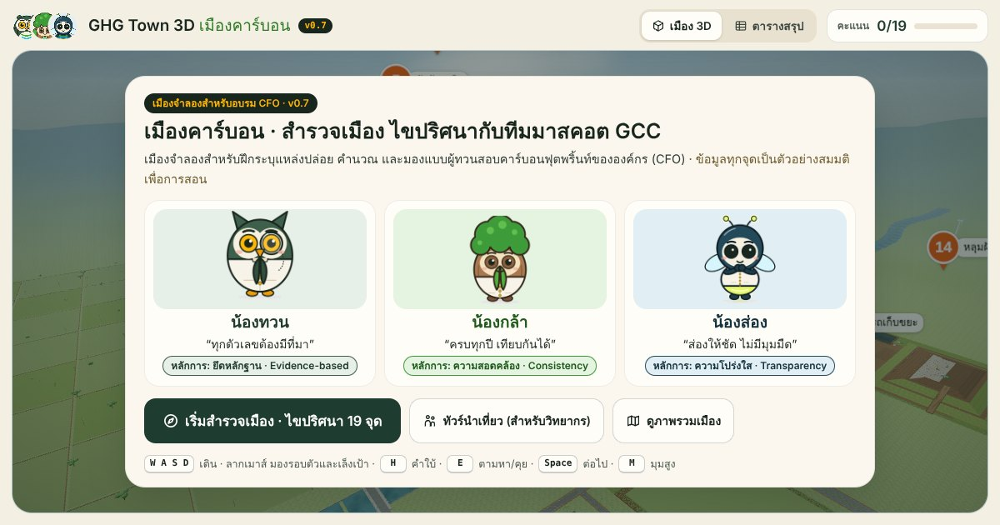

# GHG Town 3D · เมืองคาร์บอน



เมืองจำลอง 3 มิติสำหรับอบรมการคำนวณและทวนสอบคาร์บอนฟุตพริ้นท์ขององค์กร (CFO)
ผู้เรียนเดินสำรวจเมืองเอง เจอฟอง **?** ก็ไขปริศนาตามหาแหล่งปล่อยก๊าซเรือนกระจก 19 จุด
โดยมีทีมมาสคอต GCC คือ **น้องทวน** (ยึดหลักฐาน) **น้องกล้า** (ความสอดคล้อง) และ **น้องส่อง** (ความโปร่งใส) คอยอธิบายและถามคำถามแบบผู้ทวนสอบ

**เล่นออนไลน์:** <https://mktwni.github.io/carbon-town/>

## วิธีเล่น

| โหมด | ใช้ทำอะไร |
|---|---|
| **สำรวจเอง** (ค่าเริ่มต้น) | เดินไปทางไหนก็ได้ เจอฟอง ? → อ่านปริศนา → กด "ตามหาเลย" แล้วเล็งเป้ากลางจอค้างไว้ **หรือคลิก/แตะที่แหล่งปล่อย** → ทีมมาสคอตอธิบายและถามคำถาม ตอบแล้วจึงเฉลยชนิดก๊าซ/ประเภท พร้อมสูตร หลักฐาน และมุมผู้ทวนสอบ |
| **ทัวร์นำเที่ยว** | ทีมมาสคอตพาเดินครบ 19 จุดตามลำดับ เหมาะกับวิทยากรสอนหน้าห้อง |
| **มุมสูง** | ดูภาพรวมเมือง คลิกหมุดให้ทีมพาไปจุดนั้น |

หน้าจอเกมเต็มจอ มีปุ่มหลักแค่ 3 จุด

- **การ์ดซ้ายบน** (ชื่อย่าน + แถบความคืบหน้า) — กดเพื่อเปิดสมุดปริศนา
- **เดินทางด่วน** — น้องส่องพาบินโดรนไปลงใกล้ปริศนาที่ยังไม่ไขของย่านที่เลือก พร้อมบอกว่าแต่ละย่านเหลือกี่ปริศนา
- **เมนู ☰** — โหมด (สำรวจเอง / ทัวร์ / มุมสูง), ช่วงเวลาและอากาศ, เปิด/ปิดเสียง, ป้ายชื่อจุด, วิดีโอสำรวจ, เสียงบรรยาย, ตารางสรุปผล, วิธีเล่น

ตัวช่วยอื่น ๆ

- **วิดีโอสำรวจหน้างาน** — เจอแหล่งปล่อยครั้งแรก จะมีวิดีโอสั้นราว 12 วินาที: โดรนบินถ่ายมุมสูง → เดินเข้าไปหาแหล่งปล่อย → สแกนระยะใกล้พร้อมป้ายชี้แหล่งปล่อยและชนิดก๊าซ → ถ่าย **ภาพหลักฐาน** เก็บลงสมุดปริศนาและการ์ดคำถาม (กด `Space` หรือ "ข้ามวิดีโอ" ได้ · ดูซ้ำได้จากการ์ดคำถาม · ปิดได้ในเมนู)
- **มองเห็นก๊าซ** — ใกล้แหล่งปล่อยจะเห็นไอก๊าซลอยออกมาตามสีของก๊าซ (ถ้าคำถามถามชนิดก๊าซ จะเป็นไอสีจาง ๆ จนกว่าจะตอบ)
- **เสียงบรรยายภาษาไทย** — อ่านคำบรรยายในวิดีโอ บทพูดของทีมมาสคอต และคำถาม (ใช้เสียงภาษาไทยที่มีในเครื่อง เช่น Kanya บน Mac หรือเสียง Natural บน Edge) ปิดได้ในเมนู
- **วิดีโอจริงประจำจุด** — ใส่ลิงก์ YouTube หรือไฟล์วิดีโอของแต่ละจุดได้ที่ `js/media.js` การ์ดคำถามจะมีแท็บ "วิดีโอจริง" เพิ่มขึ้นมาเอง
- **คำใบ้ `H`** — น้องส่องบินไปส่องแสงที่แหล่งปล่อย มี **ลูกศรบอกทางและระยะทาง** ถ้าอยู่ไกลกดปุ่ม "บินตามไปเลย" ได้
- **บันทึกอัตโนมัติ** — ปิดหน้าหรือรีเฟรชแล้วกลับมากด "เล่นต่อจากเดิม" ได้ (เก็บในเบราว์เซอร์เครื่องนั้น ล้างได้ที่หน้าแรก)
- **เกียรติบัตร** — พิมพ์ชื่อผู้เรียนบนใบประกาศ แล้วกด "พิมพ์ / บันทึก PDF"
- **เสียงบรรยากาศ** — ลม นก รถ ฝน จิ้งหรีด เสียงเครื่องจักรในโรงงาน และเสียงฝีเท้า ปิดได้ในเมนู

ปุ่มลัด: `W A S D` เดิน · `Shift` วิ่ง · ลากเมาส์ มองรอบตัว/เล็งเป้า · คลิกพื้น เดินไปตรงนั้น · คลิกแหล่งปล่อย (ตอนตามหา) = เจอแล้ว · `E` ตามหา/คุย · `H` คำใบ้ · `1`–`4` ตอบคำถาม · `Space` ต่อไป / ข้ามวิดีโอ · `M` มุมสูง · `Esc` ปิด

มือถือ/แท็บเล็ต: แตะค้างครึ่งซ้ายของจอแล้วลากเพื่อเดิน (ลากสุดคือวิ่ง) · ลากครึ่งขวาเพื่อมองรอบตัว · จีบนิ้วเพื่อซูม

แนะนำ Chrome หรือ Edge รุ่นล่าสุดบนคอมพิวเตอร์ ใช้บนแท็บเล็ตและมือถือได้ (การ์ดคำถามจะกินพื้นที่จอมากกว่า)

## เปิดในเครื่อง

- ดับเบิลคลิก `index.html` ได้เลย ไม่ต้องติดตั้งอะไร
- หรือเปิดผ่านเว็บเซิร์ฟเวอร์ในเครื่อง (มี Node.js 18 ขึ้นไป): `npm run serve` แล้วเปิด <http://localhost:8080/>

## แก้ไขเนื้อหาและระบบ

| อยากแก้ | แก้ที่ไฟล์ | ต้อง build ไหม |
|---|---|---|
| ข้อความ คำถาม ตัวเลือก ค่า EF/GWP เฉลย บทนำ ปริศนา | `js/content.js` | ไม่ต้อง |
| วิดีโอจริงประจำจุด (ลิงก์ YouTube / ไฟล์วิดีโอ) | `js/media.js` | ไม่ต้อง |
| หน้าตา ปุ่ม การ์ด ลำดับการเล่น (UI) | `src/ui/Main.dc.html` | ต้อง → `npm run build` |
| ตัวเมือง 3 มิติ มาสคอต กล้อง การเดิน | `src/engine/*.js` | ต้อง → `npm run build` |

```bash
npm install      # ครั้งแรกครั้งเดียว (ติดตั้ง terser สำหรับย่อไฟล์)
npm run build    # สร้าง js/app.js, js/ghg3-engine.min.js, js/dc-lite.js ใหม่จาก src/
npm run serve    # ทดลองเปิดดูที่ http://localhost:8080/
```

ไฟล์ `js/app.js`, `js/ghg3-engine.min.js` และ `js/dc-lite.js` เป็นไฟล์ที่ build สร้างขึ้น ห้ามแก้ตรง ๆ

## เผยแพร่ (GitHub Pages)

เว็บจริงอยู่ที่ <https://mktwni.github.io/carbon-town/> (repository <https://github.com/MktwNi/carbon-town>)
ทุกครั้งที่ push ขึ้น branch `main` เว็บจะอัปเดตเองในราว 1 นาที (GitHub Pages ตั้งค่าเป็น **Deploy from a branch → `main` / root** และมีไฟล์ว่าง `.nojekyll` ให้เสิร์ฟไฟล์ตามเดิม)
ถ้าอยากเปลี่ยนไป deploy ด้วย GitHub Actions (เผยแพร่เฉพาะ `index.html` `js/` `assets/`) ดูวิธีที่หัวไฟล์ `src/tools/deploy-pages.yml` ส่วนขั้นตอนตั้งค่าครั้งแรกอยู่ใน [`DEPLOY.md`](DEPLOY.md)

> เว็บบน GitHub Pages เปิดดูได้ทุกคนที่มีลิงก์ ถ้าใช้บัญชี GitHub ฟรี repository ต้องเป็น public ด้วย

## โครงสร้างโปรเจกต์

```
index.html               หน้าเว็บ (โหลดสคริปต์ทั้งหมด)
js/content.js            เนื้อหาบทเรียน 19 จุด บทนำ ปริศนา (แก้ได้โดยตรง)
js/media.js              วิดีโอจริงประจำจุด (ไม่ใส่ก็ได้ · แก้ได้โดยตรง)
js/app.js                UI — สร้างจาก src/ui/Main.dc.html
js/ghg3-engine.min.js    เอนจิน 3 มิติ — สร้างจาก src/engine/
js/dc-lite.js            ตัวแสดงผลเทมเพลต — คัดลอกจาก src/ui/
js/three.min.js          three.js r149 (MIT)
assets/                  ภาพมาสคอต (sprite sheet) ไอคอน ภาพตัวอย่างลิงก์
src/engine/              ซอร์สเอนจิน 15 โมดูล (core layout sky terrain actors mascots complexes warehouse rural world play film audio post tune)
src/ui/Main.dc.html      ซอร์ส UI (ไฟล์เดียวกับเวอร์ชันใน Claude Design)
src/tools/               build.mjs (สร้างไฟล์) · serve.mjs (เซิร์ฟเวอร์ทดสอบ)
```

## ข้อมูลอ้างอิงและข้อจำกัด

- ข้อมูลกิจกรรมทุกจุดเป็น **ตัวอย่างสมมติเพื่อการสอน** ไม่ใช่ข้อมูลขององค์กรจริง
- ค่า EF อ้างอิงค่าของ อบก. สำหรับ CFO (เช่น ไฟฟ้า 0.4750 kgCO₂e/kWh) และ GWP100 ตาม IPCC AR5 ส่วนค่าเริ่มต้นอื่นอ้างอิง IPCC 2006 Guidelines ควรตรวจค่าล่าสุดที่ อบก. ประกาศก่อนนำไปใช้กับงานจริง
- มาสคอต น้องทวน น้องกล้า น้องส่อง เป็นของหน่วยทวนสอบ GCC (บริษัท โกลบอล คาร์บอน คอร์ปอเรชั่น จำกัด) ดูรายละเอียดสิทธิ์ใน [`NOTICE.md`](NOTICE.md)
- เสียงทั้งหมดสังเคราะห์สดด้วย Web Audio ในเบราว์เซอร์ ไม่มีไฟล์เสียงจากภายนอก · เสียงบรรยายใช้เสียงภาษาไทยของเครื่องผู้ใช้ (Web Speech API) ถ้าเครื่องไม่มีเสียงภาษาไทย ตัวเลือกนี้จะไม่แสดง
- วิดีโอสำรวจหน้างานสร้างสดจากเมืองจำลอง 3 มิติ (ไม่ใช่ไฟล์วิดีโอ) ภาพหลักฐานเก็บในเบราว์เซอร์เครื่องนั้น และถูกล้างพร้อมความคืบหน้า

## มีอะไรใหม่ใน v1.2

- **ห้องหม้อไอน้ำแกลบ (จุดที่ 9) แบบละเอียด:** เตาเผาหุ้มเหล็กเปิดประตูเห็นไฟ ถังเติมแกลบบนหลังเตา หม้อไอน้ำหุ้มฉนวนอะลูมิเนียม มีวาล์วนิรภัย เกจวัดความดัน หลอดแก้ววัดระดับน้ำ ท่อไอน้ำหุ้มฉนวนพร้อมวาล์วพวงมาลัยแดง ปั๊มน้ำป้อน ถังกรองน้ำ ตู้ควบคุมมีจอแสดงค่า ช่องระบายอากาศ ป้ายความปลอดภัย และถังดับเพลิง
- **ห้องเครื่องกำเนิดไฟฟ้าสำรอง (จุดที่ 6) แบบละเอียด:** เครื่องยนต์ดีเซลมีเทอร์โบ กรองอากาศ กรองน้ำมัน หม้อน้ำพัดลมหมุนจริง ไดปั่นไฟพร้อมกล่องสายไฟ ท่อไอเสียข้อต่อยืดหยุ่นขึ้นหลังคา จอควบคุม (400 V · 50 Hz · 1500 rpm) แบตเตอรี่สตาร์ท ตู้ไฟมีมิเตอร์ ถังน้ำมันในถาดกันหก และป้าย "สวมที่ครอบหูลดเสียง"
- **มินิมาร์ท (จุดที่ 1):** สินค้าทุกชิ้นมีลายบรรจุภัณฑ์ ชื่อ และราคา ขวดเครื่องดื่มมีฉลากและฝา แอร์ติดผนังแบบมีรูปทรงจริง
- **ลานจ่ายก๊าซทางการแพทย์ (จุดที่ 7):** ถัง N₂O และ O₂ มันวาวพร้อมฉลาก วาล์วทองเหลือง โซ่รัดถัง เกจวัดความดัน หัวปรับแรงดัน และป้าย "ห้ามใช้น้ำมันและจาระบี"
- **โรงอาหารโรงเรียน (จุดที่ 8):** ถังแก๊ส LPG 48 kg มีฉลาก หัวปรับแรงดัน สายอ่อน เกจและวาล์ว เครื่องตรวจจับแก๊สรั่ว ครัวมีหม้อ กระทะ ไอน้ำ อ่างล้าง และกองจาน
- **ศูนย์ราชการ (จุดที่ 2–5):** บ่อเกรอะเป็นวงบ่อปูนพร้อมฝากลมเขียน "บ่อเกรอะ 1–3" มีหูเหล็กยก ท่อระบายอากาศ PVC สีฟ้ายึดข้างผนังขึ้นไปถึงหัวรูปตัว T · หม้อแปลงบนนั่งร้านเสาคอนกรีตคู่ ตัวถังครีบลอน ฟิวส์ก้านแขวน สายแรงต่ำลงตู้ CT และตู้มิเตอร์บนเสาที่เห็นตัวเลข kWh ชัด ตู้ MDB ข้างอาคาร · โรงจอดมอเตอร์ไซค์โครงเหล็ก หลังคาเมทัลชีท รางน้ำ ช่องจอดตีเส้น บอร์ด "แบบสำรวจการเดินทางมาทำงาน" พร้อม QR และหมวกกันน็อกวางบนเบาะ · ขาตั้งถังดับเพลิงพร้อมป้ายมาตรฐาน ถัง CO₂ 15 lb 2 ถัง (หัวฉีดกรวยดำ) และถังผงเคมีแห้งที่มีเกจ ทุกถังมีฉลากและบัตรตรวจประจำเดือน บันไดหน้าอาคารขึ้นสู่ชานพักอย่างถูกทิศ
- **มอเตอร์ไซค์ทั้งเมือง:** ทำใหม่เป็นทรงรถครอบครัวจริง มีล้อแม็ก โช้คหน้า-หลัง ไฟหน้า กระจก เบาะ ท่อไอเสีย ไฟท้าย และป้ายทะเบียน
- **รถสิบล้อรับจ้าง (จุดที่ 11):** หัวเก๋งมีกระจกบังลม กระจังหน้า ไฟ กันชนโครเมียม กระจกมองข้าง ไฟหลังคา ปล่องไอเสีย ถังน้ำมัน ล้อคู่หลัง 10 ล้อ กระบะไม้ทาสี มีกระบอกไฮดรอลิกยืดตอนดั้ม ฝาท้ายแกว่งตามแรงโน้มถ่วง และป้าย "รถรับจ้าง · หจก.รุ่งเรืองขนส่ง" ที่ประตูทั้งสองข้าง
- **สถานีไฟฟ้าย่อย (จุดที่ 12):** ลานโรยหินกรวด เบรกเกอร์ SF₆ บนเสา H มีเกจวัดความหนาแน่นก๊าซ SF₆ (โซนแดง เหลือง เขียว) ที่ทุกขั้ว ตู้กลไกพร้อมป้ายชื่อ ช่างเติมก๊าซโดยตั้งถังบนเครื่องชั่ง (ชั่งก่อนและหลังเติม) หม้อแปลงกำลัง TR-1 / TR-2 มีครีบระบายความร้อน พัดลม ถังพักน้ำมันพร้อมเกจ และตู้สวิตช์เกียร์ 22 kV
- พื้นในอาคารและทางเท้าไม่มีลายเส้นกะพริบจากเงานุ่มแล้ว และเงาตามซอกมุมนุ่มลง ไม่เป็นคราบดำบนผนัง

## มีอะไรใหม่ใน v1.1

- **โกดังโรงสีแบบสมจริง (จุดที่ 10):** ชั้นวางพาเลทเสาน้ำเงิน คานส้ม เต็มไปด้วยกล่องข้าวที่พิมพ์ชื่อและบาร์โค้ด กับกระสอบข้าว สายพานลำเลียงพร้อมราวกั้นสีเหลือง พื้นอีพ็อกซีมีเส้นช่องทางเดินและลูกศร หน้าต่างรับแสงที่ผนัง และพนักงานสวมเสื้อสะท้อนแสง
- **รถโฟล์คลิฟต์ดีเซลคันใหม่:** มีหลังคานิรภัย เสายก โซ่ ล้อหมุนตามระยะทาง ไฟหมุน ไฟสีฟ้าเตือนคนเดินเท้า คนขับใส่หมวกนิรภัย ขับไปยกพาเลทวางบนชั้นจริง แล้วถอยกลับ
- **แสงและเงาในทุกอาคาร:** โคมเพดาน 2 ดวงที่ใกล้ที่สุดทอดเงาจริงลงพื้น (คน รถ ชั้นวาง เครื่องจักร) และเมื่อเดินเข้าอาคาร แสงท้องฟ้าจะลดลงให้เห็นเงาชัด
- **โทนภาพใหม่ทั้งแผนที่ "สมจริงแบบการ์ตูนนิดๆ":** สีสดและอุ่นขึ้นเล็กน้อย มีเส้นขอบบางๆ รอบวัตถุระยะใกล้ (ใช้ทั้งเมือง ทุกอาคาร)
- **คนในเมืองโค้งมนขึ้น:** คนระยะใกล้ (ไม่เกิน ~48 ม.) ใช้ตัวแบบละเอียด ระยะกลางใช้รูปทรงโค้งเรียบ ไม่เป็นเหลี่ยม คนขับโฟล์คลิฟต์ทำใหม่ให้โค้งมน
- **เงานุ่มตามมุมและจุดสัมผัส (ambient occlusion):** ทุกที่ทั้งในและนอกอาคาร วัตถุจึงดูวางอยู่บนพื้นจริง ไม่ลอย เปิดเฉพาะเครื่องที่แรงพอ และปิดเองอัตโนมัติถ้าเครื่องเริ่มหน่วง

## มีอะไรใหม่ใน v1.0

- **วิดีโอสำรวจหน้างาน** ทั้ง 19 จุด: มุมโดรน → เดินเข้าหาแหล่งปล่อย → สแกนระยะใกล้ มีแถบภาพยนตร์ ป้าย REC เวลา ความสูงโดรน ป้าย AR ชี้แหล่งปล่อยและชนิดก๊าซ คำบรรยายใต้ภาพ เสียงโดรนและชัตเตอร์ แล้วถ่ายภาพหลักฐานเก็บไว้ (รถโฟล์คลิฟต์ที่ขับไปมา กล้องจะตามรถ)
- ภาพหลักฐานแสดงในการ์ดคำถาม (กดเพื่อดูวิดีโอซ้ำ) และในสมุดปริศนาของจุดที่ไขแล้ว
- ไอก๊าซสีตามชนิดก๊าซลอยออกจากแหล่งปล่อย ให้ "เห็น" ก๊าซที่ปกติมองไม่เห็น
- เสียงบรรยายภาษาไทย (อ่านคำบรรยาย บทพูดมาสคอต และคำถาม) · แท็บ "วิดีโอจริง" สำหรับคลิปจริงที่วิทยากรใส่เองใน `js/media.js`
- การ์ดคำถามใหม่: อยู่กลางจอ อ่านง่าย ตัวเลือกปุ่มใหญ่ ตอบด้วยปุ่ม `1`–`4` ได้ ปุ่ม "สำรวจต่อ" อยู่ล่างการ์ดเสมอ
- กล่อง "สิ่งที่เห็น" ภาพหลักฐานใหญ่ขึ้น (บนมือถือเป็นภาพเต็มความกว้าง) ตัวอักษรทั้งการ์ดใหญ่ขึ้น · แท็บเฉลยเป็นแถบเดียวมีไอคอน (วิธีคำนวณ · หลักฐาน · มุมผู้ทวนสอบ · แนวทางลด · ข้อควรระวัง)

## มีอะไรใหม่ใน v0.9

- หน้าจอใหม่: เกมเต็มจอ ฟอนต์ Prompt แผงกระจกโปร่งแสง ปุ่มใหญ่กดง่าย เหลือปุ่มหลัก 3 จุด (การ์ดความคืบหน้า · เดินทางด่วน · เมนู)
- คนในเมืองสมจริงขึ้น: ระยะใกล้ (ไม่เกิน ~32 ม.) ใช้ตัวคนแบบละเอียด รูปทรงโค้งมน ใบหน้ามีตา คิ้ว จมูก ปาก ผมหลายทรง (สั้น สกินเฮด บ็อบ ยาว หางม้า) มือมีนิ้ว รองเท้า และท่าคุยกันที่เป็นธรรมชาติ
- เมืองสมจริงขึ้น: ต้นไม้ทรงพุ่มโค้งนุ่มมีแสงเงา เงาสัมผัสพื้นที่โคนกำแพงและอาคาร พื้นหญ้าไม่เป็นลายเส้น รถยนต์มีกระจกหน้า-หลังลาดเอียง
- เดินลื่นขึ้น: ใช้นาฬิกาของจอภาพ ปรับความละเอียดอัตโนมัติเมื่อเครื่องเริ่มหนัก เตรียมกราฟิกล่วงหน้าไม่ให้สะดุด และหันกล้องนุ่มขึ้น

## มีอะไรใหม่ใน v0.8

- เดินทางด่วนด้วยโดรนไปทุกย่าน · ลูกศรนำทางและระยะทางตอนขอคำใบ้ · ปุ่ม "บินตามไปเลย"
- เดินเร็วขึ้น (3.4 ม./วิ) และวิ่งด้วย `Shift` (8.5 ม./วิ) · ตอนตามหาคลิก/แตะที่แหล่งปล่อยได้เลย และเล็งง่ายขึ้น
- จอยสติ๊กแบบสัมผัสสำหรับมือถือและแท็บเล็ต · จัดหน้าจอมือถือใหม่ (แถบเครื่องมือไม่ซ้อนกัน หน้าแรกกระชับ)
- บันทึกความคืบหน้าอัตโนมัติและ "เล่นต่อจากเดิม" · ใส่ชื่อบนเกียรติบัตรและพิมพ์/บันทึก PDF
- เสียงบรรยากาศและเสียงประกอบ (ปิดได้) · โหมด "ตามเวลาจริง" เปลี่ยนเป็นเย็น/กลางคืนเองระหว่างเรียน
- แก้บั๊กแผนที่ย่อหายไปเองเมื่อมีป้ายแจ้งเตือนขึ้นหรือปิด
